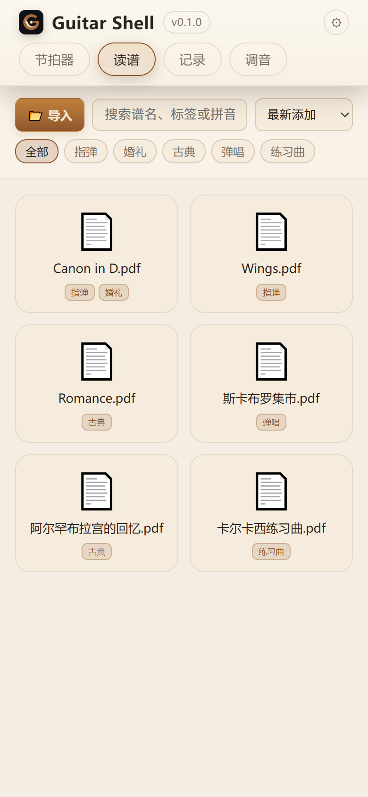
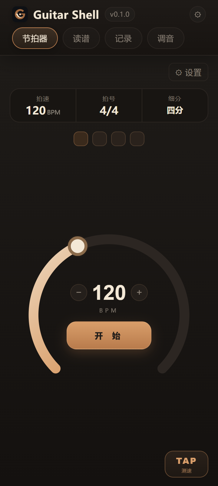
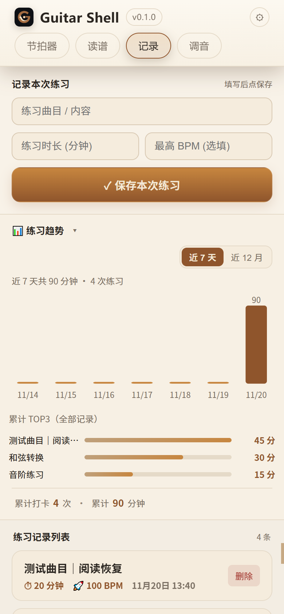
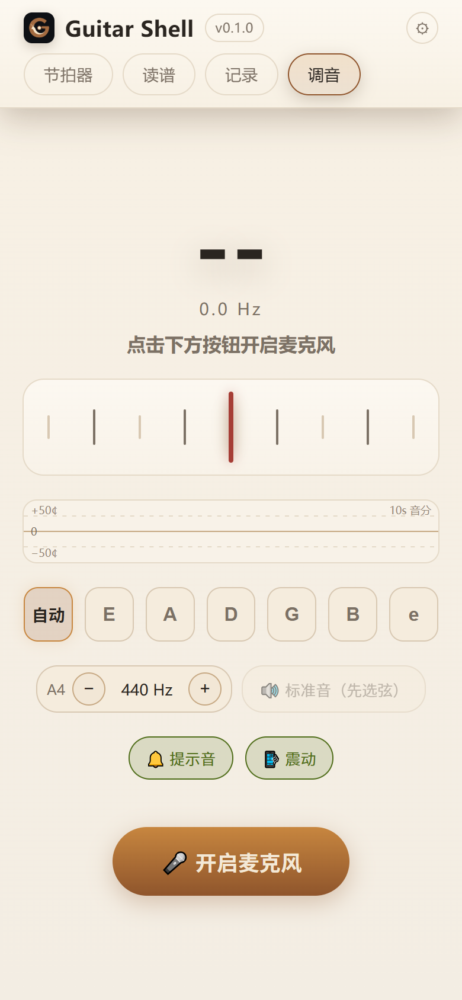
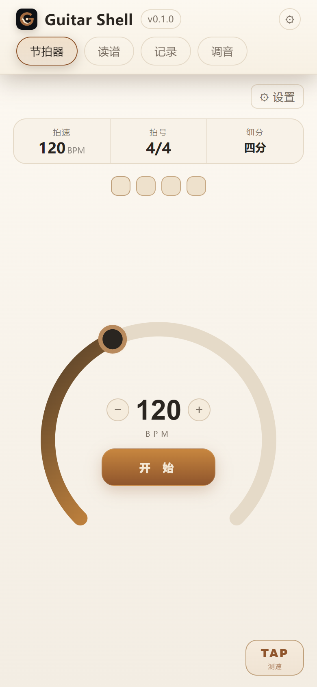
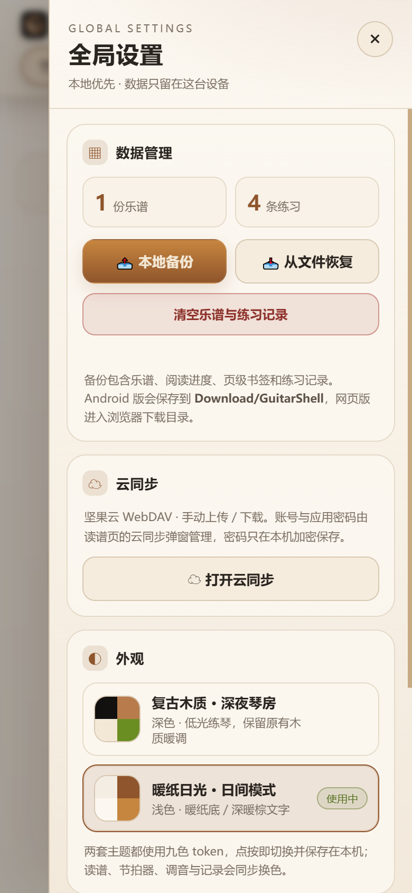
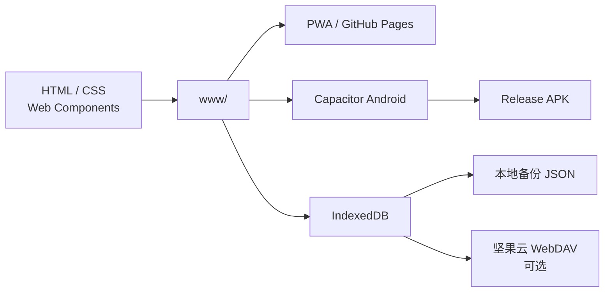

<p align="center">
  
</p>

<h1 align="center">Guitar Shell</h1>

<p align="center">
  <b>吉他手的一站式练琴工作站</b><br>
  乐谱 · 节拍 · 调音 · 练习记录，留在一个本地优先的壳里。
</p>

<p align="center">
  <a href="https://github.com/moanet/GuitarShell/releases/latest">
    
  </a>
  <a href="https://moanet.github.io/GuitarShell/">
    
  </a>
  
  
</p>

Guitar Shell 是一个本地优先的吉他练琴工作站。它把读谱、节拍器、调音器和练习记录放进同一个界面，不要求账号，默认不把乐谱与练习数据上传云端。

项目使用原生 Web Components、IndexedDB 与 Canvas 构建，网页端零构建即可运行；同一份 `www` 资源通过 Capacitor 打包为 Android 应用。界面提供「复古木质 · 深夜琴房」与「暖纸日光 · 日间模式」两套主题。

## 功能

| 模块 | 已具备 |
| --- | --- |
| 读谱 | PDF / 图片导入、书架与标签、拼音搜索、手势缩放、页级书签、阅读进度恢复、迷你节拍器、全屏阅读 |
| 节拍器 | 高精度调度、旋钮与 TAP、拍号 / 细分 / 音色、逐拍重音、Swing、变速练习、倒计时 |
| 调音器 | 麦克风采集、YIN 基频检测、自动 / 手动选弦、A4 校准、音名与音分显示、标准音试听、音分曲线 |
| 练习记录 | 时长 / BPM / 页码打卡、累计统计、SVG 趋势、TOP5、页面实时刷新 |
| 数据与同步 | IndexedDB 本地存储、完整备份与恢复、坚果云 WebDAV 手动同步、密码本机加密 |
| 外观 | 深色 / 浅色双主题、全局设置抽屉、Android 系统栏同步、启动动画 |

## 界面预览

| 读谱与书架 | 节拍器 |
| :---: | :---: |
|  |  |
| 乐谱导入、标签筛选、拼音搜索与阅读进度 | 高精度节拍、拍号、细分音色与变速练习 |

| 练习记录 | 调音器 |
| :---: | :---: |
|  |  |
| 打卡、累计时长、趋势图与最近记录 | 自动选弦、音分仪表、A4 校准与音分曲线 |

| 日间节拍器 | 全局设置 |
| :---: | :---: |
|  |  |
| 暖纸日光主题下的节拍器与播放控制 | 数据统计、备份恢复、云同步入口与主题切换 |

## 下载与安装

- **Android 正式版**：前往 [GitHub Releases](https://github.com/moanet/GuitarShell/releases/latest) 下载 `GuitarShell-0.1.0-release.apk`。
- **网页版**：打开 [https://moanet.github.io/GuitarShell/](https://moanet.github.io/GuitarShell/)。

> `0.1.0` 使用新的应用 ID `com.guitarshell`，可以与 `0.0.8.10` 并存，不覆盖旧版数据。
> 迁移旧数据时，先在旧版「全局设置 > 本地备份」导出 JSON，再在新版「从文件恢复」导入。备份包含乐谱、阅读进度、页级书签与练习记录；WebDAV 密码与主题选择需要重新设置。

## 快速上手

1. **导入乐谱**：在读谱书架点「导入」，选择 PDF、图片或拍照。导入后可按标签筛选，也可用谱名或拼音首字母搜索。
2. **开始读谱**：点开谱面后可双指缩放、拖拽，使用页级书签标记位置，点「存进度」记录当前阅读页。再次打开会自动回到上次位置。
3. **跟节拍练习**：在节拍器页设置 BPM、拍号、细分与音色；需要变速练习时开启递增 BPM 与目标小节数。读谱页底部也提供迷你节拍器。
4. **给吉他调音**：进入调音器页并允许麦克风权限，选择自动或手动选弦；可调整 A4 基准并试听标准音。
5. **记录本次练习**：在记录页填写时长、BPM 与页码并打卡，趋势面板会汇总近 7 天或近 12 个月的数据。
6. **管理数据**：全局设置抽屉集中提供本地备份、从文件恢复、清空数据、云同步与主题切换。建议在升级或清理浏览器数据前先导出备份。

## 项目结构

```text
Guitar Shell
├─ index.html                  网页入口与四大模块导航
├─ manifest.json               PWA 配置
├─ sw.js                       离线缓存与版本号
├─ css/
│  └─ layout.css               全局布局与双主题 token
├─ js/
│  ├─ components/              节拍器 / 读谱 / 练习记录 / 调音器 / 设置
│  ├─ services/                IndexedDB / 备份 / WebDAV / 主题 / 音频 / 调音算法
│  └─ lib/                     PDF.js / 拼音字典 / 本地依赖
├─ scripts/
│  └─ build-www.mjs            生成可部署的 www
├─ android/                    Capacitor Android 壳与原生插件
├─ docs/screenshots/           README 界面截图
├─ icon-gShell-*.png           应用图标
├─ CHANGELOG.md                逐版本迭代记录
└─ TASK.md                     开发任务、进度与避坑指南
```

### 构建路径



## 本地运行与构建

网页端是零构建项目，使用任意静态服务器托管仓库根目录即可。Windows 下可直接运行：

```bat
start-dev.bat
```

Android 正式包需要 Node.js、JDK 21 与 Android SDK：

```bash
npm install
npm run apk:release
```

构建产物位于 `android/app/build/outputs/apk/release/app-release.apk`。发布前请同步修改 `js/services/version.js` 与 `sw.js` 中的版本号，避免线上继续使用旧缓存。

## 数据与隐私

- 默认只把乐谱、阅读进度和练习记录保存在本机 IndexedDB。
- 云同步为可选功能，使用用户自己的坚果云 WebDAV；应用密码只保存在本机加密保险库。
- 不要求账号，不内置统计上报，不默认上传用户数据。
- 备份文件由用户主动导出，可用于换机或迁移。

## 文档

- [TASK.md](TASK.md)：开发任务、当前进度、冒烟清单、技术债与避坑指南。
- [CHANGELOG.md](CHANGELOG.md)：逐版本交付内容、测试与历史决策。
