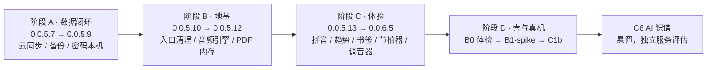

# 🎸 Guitar Shell・吉他手的一站式练琴工作站

> **项目愿景**
> 打破练琴时碎片化的工具割裂感，把乐谱管理、节拍、调音、打卡记录整合进一个高度沉浸、本地优先、跨端可用的外壳。零构建、原生 Web Components、拖拽即部署，逐步长成懂吉他手的专属工作台。

**当前状态**：`v0.0.8.7`（数据管理归拢 + Android 原生备份测试包，待真机复测；`0.0.8.6` 全局设置抽屉与读谱热区缩小已真机验收；`0.0.8.5` 启动图标已真机验收；`0.0.8.4` 的读谱提示、记录页排版、顶部品牌图标已验收；`0.0.8.3` UI 复古木质重构已真机验收并推送；`0.0.8.1` C1b 屏幕常亮验收通过；本地优先 PWA・四大模块全部可用・云同步 / 备份 / 页级书签 / 节拍器满血已上线・调音器已换 YIN（A4 校准、音名 / 音分换算、低音尾音修复）。下一步：`0.0.8.7` 真机验收 → UI 终版 → 正式签名包。


***

## 🗺️ 一、全景架构与演进图

### 1.1 当前架构


```
Guitar Shell
├── index.html                     ✅ 外壳 + 4 大导航（入口已收敛）
├── manifest.json                  ✅ PWA 配置
├── sw.js                          ✅ PWA 离线缓存（APP_VERSION = 0.0.8.7，改版本两处同步；壳内跳过注册）
├── CHANGELOG.md                   ✅ 完整迭代记录（逐版本 / 测试 / 决策；README 只留精简版）
├── start-dev.bat                  ✅ 一键启动：静态页 :8000 + Node WebDAV 代理 :8081
├── icon-gShell-32/192/512.png     ✅ 图标三件套
├── 项目目录结构.txt                ✅ 目录速览
├── css/
│   └── layout.css                 ✅ 全局布局与主题
├── js/
│   ├── main.js                    ✅ 路由 / 组件加载 / SW 注册 / 版本徽标
│   ├── services/
│   │   ├── db.js                  ✅ IndexedDB v3：scores / logs 双表
│   │   │                            tags / 阅读进度组 / bookmarks / fileHash
│   │   ├── backup.js              ✅ 全局备份 / 恢复：base64 打包、浏览器下载、原生 Downloads 写入
│   │   ├── webdav.js              ✅ 坚果云收发 + 多通道回落 + stat 冲突检测
│   │   ├── version.js             ✅ APP_VERSION / BACKUP_SCHEMA 单一来源
│   │   ├── toast.js               ✅ 全局轻提示单例（body 层，不受 shadow DOM 影响）
│   │   ├── wakelock.js            ✅ 屏幕常亮：引用计数 + 原生 / Web 双路径 + 可见性恢复
│   │   ├── vault.js               ✅ AES-GCM 存应用密码（独立库，密钥不可导出）
│   │   ├── audio.js               ✅ 全局音频引擎：单例上下文 + lookahead 调度
│   │   │                            四态拍点音色 / Swing / 单活跃互斥 / 共享麦克风分析
│   │   ├── pitch.js               ✅ YIN 基频检测 / A4 校准 / 音名与音分换算 / 中值滤波
│   │   └── ai-parser.js           ⏳ 悬置（C6 AI 识谱）
│   ├── components/
│   │   ├── metronome.js           ✅ 节拍器：旋钮 / TAP / 拍号 / 细分 / 音色
│   │   │                            逐拍重音 · Swing · 变速练习 · 倒计时
│   │   ├── sheet-reader.js        ✅ 读谱：书架 / 标签 AND / 拼音搜索 / PDF 虚拟化
│   │   │                            进度双轨制 / 页级书签 / 迷你节拍器同步
│   │   ├── practice-log.js        ✅ 练琴记录：打卡 / 累计 / SVG 趋势 / TOP5
│   │   ├── tuner.js               ✅ 调音器：麦克风 + YIN + 指针仪表
│   │   │                            A4 步进校准 / 标准音试听 / 10 秒音分曲线
│   │   └── settings.js            ✅ 全局设置抽屉：数据统计 / 本地备份 / 文件恢复 / 清空 / 云同步 / 主题 / 关于
│   └── lib/
│       ├── pdf.js / worker        ✅ PDF 解析（本地化 v3.11）
│       ├── pinyin.js              ✅ 拼音首字母字典（59.6KB，纯本地）
│       └── spark-md5.js           ⏳ 未引入（去重暂用「名称 + 大小」）
├── proxy/                         ✅ 本地 WebDAV 代理（不进线上仓库）
└── android/                       ✅ B1-spike Capacitor 壳（debug / 测试，不发布；含 KeepAwake / SaveBackup 原生插件）
```

### 1.2 演进路线





| 阶段     | 目标                     | 批次                 | 状态                  |
| ------ | ---------------------- | ------------------ | ------------------- |
| A 数据闭环 | 备份 / 恢复 / 云同步真正可用，数据不丢 | A1～A6              | ✅ 2026-11-18        |
| B 地基   | 去掉入口噪声、统一音频、控制 PDF 内存  | B3 / B2 / B4       | ✅ 0.0.5.10～0.0.5.12 |
| C 体验   | 找谱 / 统计 / 书签 / 节拍器练习能力 / 调音器专业版 | C2 / C3 / C1a / C4 / C5 | ✅ 0.0.5.13～0.0.6.5（C5 已验收） |
| D 壳与真机 | 壳前体检、宿主预演、屏幕常亮、系统能力 | B0 / B1-spike / C1b / B1-release | ✅ C1b `0.0.8.1` 已验收；UI `0.0.8.3` 已验收推送；`0.0.8.6` 已验收；`0.0.8.7` 数据管理归拢待复测 |
| 悬置     | AI 识谱（需后端代理）           | C6                 | ⚪ 不进主线              |


***

## 📊 二、进度与功能盘点


| 模块       | 进度  | 已具备                                               | 主要缺口                    |
| -------- | --- | ------------------------------------------------- | ----------------------- |
| 基础外壳     | 90% | 组件隔离、导航秒切、PWA 离线、图标、版本徽标、一键启动                     | 全局设置抽屉（主题 / 备份 / 清空收拢）  |
| 节拍器      | 95% | 高精度调度、旋钮、TAP、拍号 / 细分 / 音色、逐拍重音、Swing、变速练习、倒计时、HUD | 音频跟练（按练习曲自动对齐）          |
| 读谱器      | 92% | 书架 / 标签 AND / 拼音搜索、PDF 虚拟化、手势缩放、进度双轨、页级书签、迷你节拍器同步、全屏与控件渐隐 | 单曲抽取建卡 |
| 练琴记录     | 92% | 打卡（时长 / BPM / 页码）、累计统计、SVG 趋势、TOP5、实时刷新           | 按曲目下钻、连续打卡等彩蛋指标         |
| 调音器      | 95% | 麦克风采集、YIN 基频、指针仪表、自动 / 手动选弦、A4 步进校准（430–450，本机记忆）、音名 / 音分换算、低音尾音折叠、离页自动关麦、提示音 / 震动反馈、标准音试听、10 秒音分曲线 | 真机长时稳定性、打壳后的麦克风 / 震动权限 |
| 数据 / 服务层 | 75% | IndexedDB v3、全量备份、WebDAV 多通道、冲突检测、密码本机加密、统一音频引擎、常亮服务   | 云同步自动定时上传（当前手动）         |
| 壳 / 真机层  | 35% | B1-spike `0.0.7.2` / `0.0.7.3` 真机验收；后台 / 锁屏节拍器实测续响；`0.0.8.1` 原生 / Web 常亮 | 长时 Doze 兜底、正式签名、真机权限稳定性 |


***

## 🚀 三、运行与部署

### 本地开发（Windows）


```
start-dev.bat
```

一条命令同时启动：


* **PWA 网页**：`http://192.168.0.200:8000`（手机连同一 Wi-Fi 即可访问）

* **WebDAV 代理**：`http://192.168.0.200:8081`（Node 处理 CORS，转发坚果云）

> 单独调试代理：
>
> `cd proxy && npm install && node proxy.js`

### 部署（GitHub Pages）


1. 仓库设为 **Public**，文件放根目录（`index.html` 即入口）。

2. Settings → Pages → Source 选 `main` / `(root)` → Save。

3. **每次发布务必同步升级** `sw.js` 的 `APP_VERSION`，否则线上继续吃旧缓存。

4. 麦克风与 IndexedDB 持久化需要 HTTPS，Pages 天然满足。

5. `proxy/`、`start-dev.bat`、`node_modules` 已被 `.gitignore` 过滤。


***

## 🧬 四、迭代记录（精简）

### 4.1 版本时间线

| 版本 | 阶段 / 批次 | 状态 |
| --- | --- | --- |
| 0.0.5.6 | 基线：四大模块可用 | 已推送 |
| 0.0.5.7～0.0.5.9 | A 数据闭环：云同步 / 备份 / 密码本机 | 已推送 |
| 0.0.5.10～0.0.5.12 | B 地基：入口清理 / 音频引擎 / PDF 内存 | 已推送 |
| 0.0.5.13～0.0.5.14 | C 找谱 / 练习趋势 | 已推送 |
| 0.0.5.15～0.0.6.0 | C1a 页级书签 + C4 节拍器满血 | 已验收推送 |
| 0.0.6.1～0.0.6.5 | C5 调音器专业版 | 已验收推送 |
| 0.0.7.0 | B0 打壳前体检 + B1-spike 预演包 | 已验收推送 |
| 0.0.7.1～0.0.7.2 | B1-spike 真机反馈修复 + 低音弦响度补偿 | 已验收推送 |
| 0.0.7.3 | 迷你节拍器步进 / 提示音抗干扰 / 读谱全屏与控件渐隐 | 已验收推送 |
| 0.0.8.0 | C1b 首包（原生插件通道未生效） | 已被 0.0.8.1 取代 |
| 0.0.8.1 | C1b 屏幕常亮（nativePromise 通道修正） | 已验收推送 |
| 0.0.8.3 | UI 复古木质 / 深夜琴房重构（9 色 token 全局换肤） | 已真机验收推送 |
| 0.0.8.4 | UI 细节修正第一版（图标未通过，被 0.0.8.5 取代） | 读谱 / 记录页 / 顶部图标已验收 |
| 0.0.8.5 | 启动图标缩放 / 全局去蓝色选中框 / 节拍器木鱼音色 | 图标已真机验收推送 |
| 0.0.8.6 | 全局设置抽屉 / 读谱翻页热区缩小 | 已真机验收 |
| 0.0.8.7 | 数据管理归拢 / 原生备份 / 读谱书架精简 / 齿轮右对齐 | 测试包待真机复测 |

### 4.2 详细记录

完整逐版本交付、测试用例、壳层风险决策与历史专题已迁到根目录 **`CHANGELOG.md`**；README 只保留阶段、版本和当前进度。

***


## 📋 五、下一步任务看板（活跃）

> **基线**：`v0.0.8.7`（数据管理归拢 + 原生备份测试包待复测；`0.0.8.6` 设置抽屉与读谱热区已验收；`0.0.8.5` 启动图标已验收；`0.0.8.3` UI 重构已验收；`0.0.7.3` / `0.0.8.1` 真机验收通过；C1b 屏幕常亮已完成）。四大模块可用；当前进入 UI 终版前验收。
> **推进原则**：切香肠、跑通闭环、拒绝烂尾。每批收尾固定动作：升 `APP_VERSION` → 语义化 commit → 打 tag → 跑冒烟清单。

### 🧪 冒烟清单（每批收尾必跑）


* [ ] 导入 PDF / 图片 → 书架出卡

* [ ] 打开谱 → 缩放拖拽 → 📍 存进度 → 返回书架 → 重开仍在同一页

* [ ] 左右热区切歌 → 目标谱回到上次位置（A↔B 不退回第一页）

* [ ] 打卡 → 记录页自动刷新并显示页码

* [ ] 本地备份 → `Download/GuitarShell` 有 JSON → 清库 → 从文件恢复，乐谱 / 打卡 / 进度 / 书签完整

* [ ] 云上传 → 另一台设备云下载，书架与进度一致

* [ ] 节拍器与迷你节拍器不同时发声；调音器能识别六弦

* [ ] 调音页：A4 步进到 432 → 标准音试听 → 音分曲线随拨弦起伏；切离页面麦克风立即关闭

* [ ] 调准时只提示 / 震动一次，开关可关；刷新后 A4 与开关状态保留

* [ ] 打包后锁屏 / 切后台，节拍与调音不中断

* [ ] 节拍器播放 / 读谱打开 / 调音监听时屏幕常亮；停止或切走后恢复系统熄屏

### 任务队列


| # | 任务                       | 状态  | 依赖            | 备注                                                     |
| - | ------------------------ | --- | ------------- | ------------------------------------------------------ |
| 1 | **C5 调音器专业版**            | ✅ 已验收 | 依赖 `audio.js` | YIN + A4 步进 / 标准音 / 音分曲线 + 离页关麦 + 反馈；明细见 `CHANGELOG.md` |
| 2 | **B0 打壳前体检**            | ✅ 已验收 | C5 验收通过       | manifest / SW / toast / 安全区；360px 审计通过；已推送 |
| 3 | **B1-spike Capacitor 预演包** | ✅ `0.0.7.3` 已验收 | B0 验收通过 | `0.0.7.2` 真机确认；后台 / 锁屏节拍器可续响。`0.0.7.3` 修 mini 节拍器步进、提示音检测干扰、读谱全屏 + 控件渐隐，已真机复测通过 |
| 4 | **C1b 屏幕常亮** | ✅ `0.0.8.1` 已验收 | B1-spike | 常亮走原生 `FLAG_KEEP_SCREEN_ON`，网页回退 Screen Wake Lock；引用计数 + 可见性恢复；壳内经 `nativePromise('KeepAwake')` 调用；后台 / 锁屏续响已由真机验证 |
| 4b | **UI 复古木质重构** | ✅ `0.0.8.3` 已真机验收并推送 | C1b | 青绿极客风 → 深夜木质琴房 / 咖啡馆风；统一 9 色 token，节拍器 / 调音器 / 读谱 / 记录四模块同步换肤 |
| 4c | **UI 细节修正** | ✅ `0.0.8.5` 图标已验收 | 4b | 0.0.8.4 已通过读谱提示 / 记录页排版 / 顶部图标；0.0.8.5 重做缩小 G 的启动图标、清除按钮蓝色选中框、节拍器“三角”换“木鱼”；读谱箭头热区转 0.0.8.6 |
| 4d | **全局设置抽屉** | ✅ `0.0.8.6` 已真机验收 | 4c | 齿轮入口 + 右侧抽屉：数据备份 / 恢复 / 清空、当前主题、关于；读谱左右热区从整屏缩到 170px 高 |
| 4e | **数据管理归拢 / 原生备份** | 🔵 `0.0.8.7` 待真机复测 | 4d | 备份 / 恢复 / 清空 / 云同步全部收进设置抽屉；读谱书架只留导入 / 搜索 / 标签 / 书架；导入移到搜索行最左；齿轮移到右上与品牌图标对称；Android 备份写入 `Download/GuitarShell` |
| 5 | **UI 终版** | 待办 | 4d | 视觉 / 文案最后冻结，准备正式签名包 |
| 6 | **B1-release 正式签名包**     | 最后  | UI 终版         | 签名、版本号、安装升级、发布流程                                       |
| 7 | **C6 AI 识谱**             | 悬置  | 独立后端          | 需要模型 key 与代理，不进主线                                      |

> 已归档：C5a（0.0.6.1）、C5a 补丁（0.0.6.2 / 0.0.6.3）、C5b（0.0.6.4）、C5 UI 收尾（0.0.6.5）合并为 C5；完整细节见根目录 `CHANGELOG.md`。

### 当前进度

- **B0 打壳前体检** ✅ 已验收并推送（`0800edc` / `v0.0.7.0`）；manifest / SW / toast / 安全区已完成，详细风险决策见 `CHANGELOG.md`。
- **B1-spike Capacitor 预演包** ✅ `0.0.7.2` 真机验收通过；后台 / 锁屏节拍器实测可续响。
    - 已验收包：`GuitarShell-B1-spike-0.0.7.2-debug.apk`（GitHub Pre-release）
- **0.0.7.3 体验修复** ✅ 真机验收通过（`135aaff` / `v0.0.7.3`）：
    - mini 节拍器 `+ / −` 可调 BPM，播放中实时变速；
    - 调准提示音触发后 420ms 内暂停检测，避免指针被“叮”拉偏；
    - 读谱右侧 `+ / − / 全屏` 竖排，全屏隐藏工具栏并覆盖整个视口，控件与 mini 节拍器同样渐隐。
- **C1b 屏幕常亮** ✅ 真机验收通过（`a9d4b2b` / `v0.0.8.1`）：
    - `js/services/wakelock.js` 统一管理常亮，按 reason 引用计数，支持多页面同时持有；
    - 壳内调用 `KeepAwake` 原生插件（`FLAG_KEEP_SCREEN_ON`），网页回退 `navigator.wakeLock.request('screen')`；
    - 零构建壳没有 `Capacitor.Plugins` 命名空间，原生通道改为 `Capacitor.nativePromise('KeepAwake', 'enable' / 'disable')`；
    - 节拍器播放 / 读谱打开 / 调音监听自动申请；停止、返回书架、切页即释放；
    - `visibilitychange` 页不可见时释放，回到前台仍需要时常亮自动补申请。
- **UI 复古木质重构** ✅ `0.0.8.3` 已真机验收并推送：
    - 全局 9 色 token：`#121110 / #1E1B18 / #2C2622 / #B87B4C / #F3E8D6 / #D99E6A / #EAE3D9 / #8A8075 / #6B8E23 / #B54A42`；
    - 外壳、节拍器、调音器、读谱、练琴记录同步换肤；去掉青蓝 / 亮绿 / 霓虹发光，统一暖木圆角；
    - 节拍器旋钮奶白→木棕，调音命中橄榄绿，读谱卡片 / 标签 / 按钮木质调，记录柱状图木棕 / 琥珀、今日奶白；
    - `0.0.8.3` 已真机验收，代码与 README 已推送 GitHub；下一批 `0.0.8.4` 处理图标、读谱提示与记录页排版。
- **UI 细节修正** ✅ `0.0.8.5` 启动图标已真机验收通过：
    - `0.0.8.4` 已真机验收通过：顶部标题栏去掉吉他 emoji，改用项目内 `icon-gShell-192.png` 自有图标；读谱恢复提示改为“上次读到的位置”，停留时间与“已恢复上次练习速度”统一为 2 秒；记录页默认展示“记录本次练习”和“练习记录列表”，“练习趋势”收为一行，点击展开图表，累计打卡 / 累计分钟移入趋势面板最下方。
    - `0.0.8.4` 未通过项：Android 启动图标前景铺满，G 过大且背景被系统染棕；已改为独立 legacy 图标资源，按截图右侧 `GShell` 比例将源图缩至约 95%（G 约占图标 74%），四周保留近黑留白，并避开自适应背景动态着色。
    - 全局清除按钮蓝色矩形选中框 / 焦点框：顶部四个页面切换按钮、记录页“保存这次练习”“练习趋势”“近 7 天 / 近 12 月”、标题右侧版本徽标、读谱左右翻页热区 `navPrev` / `navNext`，以及四个 Shadow DOM 组件内其余按钮统一 `outline: none !important` 与 `-webkit-tap-highlight-color: transparent`。
    - 节拍器音色“三角”替换为“木鱼”：`audio.js` 新增木腔双共振 + 短噪声瞬态的独立合成，旧存档 `triangle` 自动迁移为 `woodblock`；节拍器与读谱迷你节拍器共用同一音色。
- **全局设置抽屉** ✅ `0.0.8.6` 已真机验收：
    - 顶部齿轮打开右侧抽屉：数据管理（乐谱 / 练习条数、存储占用、本地备份、从文件恢复、清空数据）、外观（当前唯一主题）、关于（自有图标与版本）。
    - `js/services/backup.js` 统一备份格式与恢复流程；设置里恢复 / 清空后广播 `gs-data-changed` / `log-updated`，读谱书架与记录页即时刷新。
    - 读谱左右翻页热区从整屏高度缩到谱面中线附近 `170px` 高，保留左右翻页但不再有整条灰色触发区；仍无蓝色焦点框 / 点按高亮。
- **数据管理归拢 / 原生备份** 🔵 `0.0.8.7` 测试包待真机复测：
    - 备份 / 恢复 / 清空 / 云同步全部收进全局设置抽屉；云同步入口自动切到读谱页并打开原有 WebDAV 弹窗。
    - 读谱页删除顶部数据工具条，书架只保留「导入 + 搜索 + 排序 + 标签 + 书架」；导入按钮移到搜索行最左侧，移动端仍打开拍照 / 相册 / 文件选择。
    - 顶部齿轮移到品牌行最右侧，左右留白均为 `20px`，与 26px 品牌图标形成对称；版本徽标留在标题旁。
    - Android 新增 `SaveBackup` 原生插件：API 29+ 用 MediaStore 写入 `Download/GuitarShell/`，API 22–28 申请存储权限后写入公共 Download；网页端仍下载到浏览器目录。
    - 备份文件名增加秒级时间戳（`GuitarShell-backup-YYYYMMDD-HHmmss.json`），避免连续备份同名覆盖。
    - 测试包 `GuitarShell-B1-spike-0.0.8.7-debug.apk`（5,125,523 字节，SHA-256 `414A360C03210AB4C9345E88DD5D321FF52075A4E2AA8A5244205B3A35577F43`，`versionCode 17`，debug 签名校验通过）。
- **下一步**：`0.0.8.7` 真机验收 → UI 终版 → 正式签名包。
- **详细记录**：B0 清单、壳层风险表、`0.0.7.1～0.0.8.7` 修复细节与测试用例都在根目录 `CHANGELOG.md`。

### ⚪ 悬置：C6 AI 识谱

模型 key 不能放前端仓库，必须再配后端代理，等于第二条网络依赖，与「网络只保留云同步」冲突。等壳层预演之后独立评估。

### 🧹 技术债备忘（随批次顺路清）


* [ ] `spark-md5.js` 未引入 → `fileHash` 恒为空，去重仍靠「名称 + 大小」，改名即重复。**（延后，不阻塞 B1）**

* [x] `manifest.json` 的 `start_url` / `scope` 已改为相对 `./`，本地 :8000、Pages 子目录与 APK 均可解析。**（B0 已完成）**

* [x] 已补 `CHANGELOG.md`；提交继续按 `feat:` / `fix:` / `chore:` 规范。**（B0 已完成）**

* [x] `sw.js` 的 `base` 死代码已删除；`ASSETS_TO_CACHE` 已与实际 import 对齐并补入 `toast.js`。**（B0 已完成）**

* [x] APK 内 Service Worker 策略已定：壳内跳过注册、网页端保留。**（B0 已完成）**

* [x] 调音器麦克风失败已改为应用内 toast + 状态提示，并复位按钮 / 停止音轨。**（B0 已完成）**

* [ ] 拼音词典只到首字母：不支持全拼与模糊纠错；次读音可能带来轻微误匹配。**（延后，不阻塞 B1）**

* [ ] 云同步仍为手动触发，未做定时 / 退出前提醒。**（延后，不阻塞 B1）**


***

## 💡 六、给开发者的避坑指南（写给未来的自己）


1. **缓存魔咒**：改代码必须升 `sw.js` 的 `APP_VERSION`，否则 cache-first 永远喂旧文件。

2. **路径刺客**：`pdf.js` 用 `./js/lib/...` 相对路径本地化加载，手机端浏览器极严格。

3. **音频叠加**：lookahead `setInterval` 退出务必 `clearInterval`；主 / 迷你节拍器互斥交给引擎，不靠事件。

4. **切勿推倒重来**：零构建、原生 Web、拖拽部署是最敏捷的武器；切香肠，享受微小迭代。

5. **进度双轨制**：手动 + 弱自动；**不要**改成「滚动即写库」—— 那正是旧版永远滞后一个会话的根源。

6. **恢复要原子**：先把 dataURL 全部转 Blob 并校验，全部成功后才清库写入；顺序反过来会中途清空用户数据。

7. **iframe 已死**：PC 端曾用浏览器 PDF 阅读器，它劫持滚动与事件；换回 iframe 会连带摧毁进度、热区与节拍器虚化。

8. **加字段 ≠ 升库版本**：object store 无固定表结构，新字段只需读写时归一化缺省值，不必动 `DB_VERSION`。

9. **DOM 引用别靠闭包**：跨函数修改的 UI 用 `this.shadowRoot.getElementById()` 实时取，避免停止按钮失效。

10. **浮层脱离滚动容器**：热区 / 药丸 / 迷你节拍器挂 `:host` 直属层并 `position:absolute`，左右留 20px+ 安全距离。

11. `!important`**&#x20;会打败内联样式**：需要 JS 控制显隐的元素，样式表不要加 `!important`。

12. **切歌前先存位**：返回书架、左右翻页都必须先 `saveReadingProgress()`。

13. **云同步通道必须能换**：端点绝不写死；排查先点「测试连接」。被静态 import 的服务文件必须进 `ASSETS_TO_CACHE`。

14. **版本号有两处**：`sw.js` 与 `js/services/version.js` 同步改；新文件进缓存清单。

15. **同步点 key 带路径**：`gs_cloud_sync:<path>`，换账号 / 路径不会误判。

16. **密码只进 vault**：AES-GCM、密钥不可导出；不写 localStorage、不进备份、不 `console.log`；局域网 http 自动隐藏保存功能。

17. **音频只走&#x20;**`audio.js`：组件里禁止 `new AudioContext()` / `close()`；发声用 `click()` / `startMetronome()`，麦克风用 `openAnalyser()`。

18. **节拍互斥在引擎里**：`startMetronome()` 自动停上一路并回调 `onStop('preempted')`；组件只在 `preempted` 时复位按钮，避免递归停。

19. **变速练习的 N 有两层含义**：每 N 小节加一档，抵达目标后也保持 N 小节再停；`rampHoldBars` 从 0 起算，避免刚到位就收工。

20. **低音弦尾音会锁到二次谐音**：E2 基频衰减后只剩 164.8Hz，YIN 会当成 D3；检测结果必须先经 `foldToGuitarFundamental()` 按六弦目标折叠，再进中值滤波。正常 E4（329.6Hz）本身是弦目标，不能被折成 A2。

21. **调音器离页必须真关麦**：组件是常驻 DOM、切页只换 `active` 类，不会触发 `disconnectedCallback`；必须监听 `app-tab-changed` 主动 `stopTuner()`。异步 `getUserMedia` 要用 `stopEpoch` 作废旧请求，否则刚点开启就切页会把麦克风偷偷打开。

22. **标准音试听会串进麦克风**：扬声器播参考音时若不暂停检测，麦克风会把 1.2 秒正弦当成琴声、污染音分曲线；用 `isPlayingRef` 跳过检测，结束后清空历史再恢复。

23. **自定义音效是两处开关**：替换内置“叮”要同时改 `audio.js` 的 `CUSTOM_CHIME_URL` 与 `sw.js` 缓存清单，漏一处就会离线回落到合成音或加载失败。