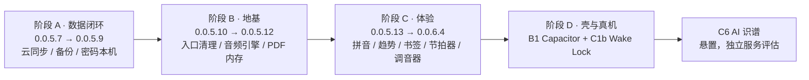

# 🎸 Guitar Shell・吉他手的一站式练琴工作站

> **项目愿景**
> 打破练琴时碎片化的工具割裂感，把乐谱管理、节拍、调音、打卡记录整合进一个高度沉浸、本地优先、跨端可用的外壳。零构建、原生 Web Components、拖拽即部署，逐步长成懂吉他手的专属工作台。

**当前状态**：`v0.0.6.4`（C5 调音器专业版交付，待真机验收）・本地优先 PWA・四大模块全部可用・云同步 / 备份 / 页级书签 / 节拍器满血已上线・调音器已换 YIN（A4 校准、音名 / 音分换算、低音尾音修复），并具备离页自动关麦、调准提示音 / 震动反馈、A4 步进校准、标准音试听、10 秒音分曲线；提示音预留自定义音效占位。


***

## 🗺️ 一、全景架构与演进图

### 1.1 当前架构


```
Guitar Shell
├── index.html                     ✅ 外壳 + 4 大导航（入口已收敛）
├── manifest.json                  ✅ PWA 配置
├── sw.js                          ✅ PWA 离线缓存（APP_VERSION = 0.0.6.4，改版本两处同步）
├── start-dev.bat                  ✅ 一键启动：静态页 :8000 + Node WebDAV 代理 :8081
├── icon-gShell-32/192/512.png     ✅ 图标三件套
├── 项目目录结构.txt                ✅ 目录速览
├── css/
│   └── layout.css                 ✅ 全局布局与主题
├── js/
│   ├── main.js                    ✅ 路由 / 组件加载 / SW 注册 / 版本徽标
│   ├── services/
│   │   ├── db.js                  ✅ IndexedDB v3：scores / logs 双表
│   │   │                            tags / 阅读进度组 / bookmarks / fileHash
│   │   ├── webdav.js              ✅ 坚果云收发 + 多通道回落 + stat 冲突检测
│   │   ├── version.js             ✅ APP_VERSION / BACKUP_SCHEMA 单一来源
│   │   ├── vault.js               ✅ AES-GCM 存应用密码（独立库，密钥不可导出）
│   │   ├── audio.js               ✅ 全局音频引擎：单例上下文 + lookahead 调度
│   │   │                            四态拍点音色 / Swing / 单活跃互斥 / 共享麦克风分析
│   │   ├── pitch.js               ✅ YIN 基频检测 / A4 校准 / 音名与音分换算 / 中值滤波
│   │   └── ai-parser.js           ⏳ 悬置（C6 AI 识谱）
│   ├── components/
│   │   ├── metronome.js           ✅ 节拍器：旋钮 / TAP / 拍号 / 细分 / 音色
│   │   │                            逐拍重音 · Swing · 变速练习 · 倒计时
│   │   ├── sheet-reader.js        ✅ 读谱：书架 / 标签 AND / 拼音搜索 / PDF 虚拟化
│   │   │                            进度双轨制 / 页级书签 / 迷你节拍器同步
│   │   ├── practice-log.js        ✅ 练琴记录：打卡 / 累计 / SVG 趋势 / TOP5
│   │   ├── tuner.js               ✅ 调音器：麦克风 + YIN + 指针仪表
│   │   │                            A4 步进校准 / 标准音试听 / 10 秒音分曲线
│   │   └── settings.js            ⏳ 全局设置抽屉（未开工）
│   └── lib/
│       ├── pdf.js / worker        ✅ PDF 解析（本地化 v3.11）
│       ├── pinyin.js              ✅ 拼音首字母字典（59.6KB，纯本地）
│       └── spark-md5.js           ⏳ 未引入（去重暂用「名称 + 大小」）
├── proxy/                         ✅ 本地 WebDAV 代理（不进线上仓库）
└── android/                       ⏳ 待生成（Capacitor 打壳）
```

### 1.2 演进路线





| 阶段     | 目标                     | 批次                 | 状态                  |
| ------ | ---------------------- | ------------------ | ------------------- |
| A 数据闭环 | 备份 / 恢复 / 云同步真正可用，数据不丢 | A1～A6              | ✅ 2026-11-18        |
| B 地基   | 去掉入口噪声、统一音频、控制 PDF 内存  | B3 / B2 / B4       | ✅ 0.0.5.10～0.0.5.12 |
| C 体验   | 找谱 / 统计 / 书签 / 节拍器练习能力 / 调音器专业版 | C2 / C3 / C1a / C4 / C5 | ✅ 0.0.5.13～0.0.6.4（0.0.6.4 待验收） |
| D 壳与真机 | 锁屏续响、常亮、系统能力           | B1 / C1b           | ⏳ 最后做               |
| 悬置     | AI 识谱（需后端代理）           | C6                 | ⚪ 不进主线              |


***

## 📊 二、进度与功能盘点


| 模块       | 进度  | 已具备                                               | 主要缺口                    |
| -------- | --- | ------------------------------------------------- | ----------------------- |
| 基础外壳     | 90% | 组件隔离、导航秒切、PWA 离线、图标、版本徽标、一键启动                     | 全局设置抽屉（主题 / 备份 / 清空收拢）  |
| 节拍器      | 95% | 高精度调度、旋钮、TAP、拍号 / 细分 / 音色、逐拍重音、Swing、变速练习、倒计时、HUD | 音频跟练（按练习曲自动对齐）          |
| 读谱器      | 92% | 书架 / 标签 AND / 拼音搜索、PDF 虚拟化、手势缩放、进度双轨、页级书签、迷你节拍器同步 | Wake Lock（归 C1b）、单曲抽取建卡 |
| 练琴记录     | 92% | 打卡（时长 / BPM / 页码）、累计统计、SVG 趋势、TOP5、实时刷新           | 按曲目下钻、连续打卡等彩蛋指标         |
| 调音器      | 95% | 麦克风采集、YIN 基频、指针仪表、自动 / 手动选弦、A4 步进校准（430–450，本机记忆）、音名 / 音分换算、低音尾音折叠、离页自动关麦、提示音 / 震动反馈、标准音试听、10 秒音分曲线 | 真机长时稳定性、打壳后的麦克风 / 震动权限 |
| 数据 / 服务层 | 75% | IndexedDB v3、全量备份、WebDAV 多通道、冲突检测、密码本机加密、统一音频引擎   | 云同步自动定时上传（当前手动）         |
| 壳 / 真机层  | 0%  | —                                                 | Capacitor 打包、前台服务、锁屏续响  |


***

## 🚀 三、运行与部署

### 本地开发（Windows）


```
start-dev.bat
```

一条命令同时启动：


* **PWA 网页**：`http://192.168.0.200:8000`（手机连同一 Wi-Fi 即可访问）

* **WebDAV 代理**：`http://192.168.0.200:8081`（Node 处理 CORS，转发坚果云）

> 单独调试代理：
>
> `cd proxy && npm install && node proxy.js`

### 部署（GitHub Pages）


1. 仓库设为 **Public**，文件放根目录（`index.html` 即入口）。

2. Settings → Pages → Source 选 `main` / `(root)` → Save。

3. **每次发布务必同步升级** `sw.js` 的 `APP_VERSION`，否则线上继续吃旧缓存。

4. 麦克风与 IndexedDB 持久化需要 HTTPS，Pages 天然满足。

5. `proxy/`、`start-dev.bat`、`node_modules` 已被 `.gitignore` 过滤。


***

## 🧬 四、迭代记录

### 4.1 版本时间线


| 版本                | 批次            | 主要交付                                                        | 状态                    |
| ----------------- | ------------- | ----------------------------------------------------------- | --------------------- |
| 0.0.5.6           | 基线            | 四大模块可用，进度双轨制成形                                              | 已推送                   |
| 0.0.5.7 → 0.0.5.9 | A             | 云同步全链路：多通道回落、冲突检测、空备份保护、载荷规范化、密码本机加密、版本徽标                   | 已推送                   |
| 0.0.5.10          | B3            | 入口清理：`main.js` 只引一次、`<meta>` 归位、图标 /manifest/ 样式去重          | 已推送（`8adc92f`）        |
| 0.0.5.11          | B2            | 抽出 `audio.js` 单例：共享上下文、统一 lookahead、引擎内互斥、掐尾音               | 已推送                   |
| 0.0.5.12          | B4            | PDF 虚拟化 + 分辨率自适应 + 串行可取消渲染 + 关谱释放                           | 已推送（`acc2e89`）        |
| 0.0.5.13          | C2            | 拼音首字母字典 + 中文 / 英文 / 拼音搜索 + 标签多选 AND                         | 已推送（`bcdf253`）        |
| 0.0.5.14          | C3            | 练习趋势 SVG（近 7 天 / 近 12 月）+ 汇总 + TOP5                         | 已推送（`4dccd2e`）        |
| 0.0.5.15          | C1a + C4      | 页级书签；节拍器逐拍重音 / Swing / 变速 / 倒计时 / 迷你同步                      | 并入 0.0.6.0            |
| 0.0.6.0           | C1a + C4 + 文档 | 页级书签；节拍器满血（变速到目标保持 N 小节再停）；README 全面重构（架构 / 盘点 / 迭代 / 看板归档） | ✅ 2026-11-19 验收通过，已推送 |
| 0.0.6.1           | C5a           | 调音器底层：YIN 基频 + A4 校准（430–450）+ 音名 / 音分换算 + 中值滤波；低音 E2 尾音谐波折叠；30fps 节流与置信度门限 | 并入 0.0.6.4 |
| 0.0.6.2           | C5a 补丁       | 离页自动关麦、按钮复位；调准时提示音 + 震动反馈，双开关并本机记忆 | 并入 0.0.6.4 |
| 0.0.6.3           | C5a 补丁       | 提示音从节拍器式短音改为独立双分音（2093 + 4186Hz）清脆“叮” | 并入 0.0.6.4 |
| 0.0.6.4           | C5b           | A4 步进校准 UI、标准音试听（播放时暂停检测）、10 秒音分曲线；自定义调准音效占位；六弦精度与节拍器共存用例 PASS | ⏳ 待真机验收，未推送 |

### 4.2 已完成批次归档

**阶段 A・云同步（0.0.5.7～0.0.5.9）**


* 端点由写死本地代理改为多通道：本地代理（仅 http 调试页）→ 自建域名 `dav.noamet.ccwu.cc` → workers.dev；用户手填通道永远最高优先，超时 / 5xx 自动换线，全失败才报错。

* 冲突检测：同步成功后按备份路径存「时点 + etag」；上传前 `stat()` 比对，云端变过就提示；下载前用 `getLocalChangeStamp()` 判断本地是否动过。

* 空备份保护：0 谱 0 记录时强提示将被清空的数量，取消即不写库。

* 载荷规范化：`version` 取 `APP_VERSION`、新增 `schema`、恢复前校验结构；另补「备份版本 + 文件名转义」。

* 应用密码：`vault.js` AES-GCM 加密，密钥不可导出、独立库存储；明文不进 localStorage / 备份 / 日志。

* 验收：手机 4G + 电脑「覆盖本地」全链路通过；A 机上传 → B 机再上传弹出「云端被改过」。

**阶段 B・地基（0.0.5.10～0.0.5.12）**


* **B3 入口清理**：去掉重复的 `loadComponents()`、`<meta>` 全部回 `<head>`、静态资源只留一份。

* **B2 音频引擎**：单例 `AudioContext` + `masterGain`；节拍只保留一份 lookahead；每路独立总线，停止即静音，掐掉已排队的 100ms 尾音；`setBpm` 把下一拍往回收；调音器改用 `openAnalyser()`，不再 `close()`。

* **B4 PDF 内存**：所有页先建 `aspect-ratio` 占位；只保留可见页 ±3 的位图，滚出即 `canvas.width=0` + `page.cleanup()`；位图密度按实际宽度 × min (DPR,2)；渲染串行可取消，关谱 `pdf.destroy()`。实测 40 页首页只活 4 页 11.8MB，滚到第 30 页只保 7 页。

**阶段 C・体验（0.0.5.13～0.0.6.4）**


* **C2 找谱**：`pinyin.js` 覆盖 U+3400～U+9FFF 共 27648 字，纯本地；搜索支持中文 / 英文 / 拼音首字母子序列；标签改多选 AND。13 条用例 PASS。

* **C3 趋势**：近 7 天 / 近 12 月手写 SVG 柱状图、今天 / 本月高亮、汇总、TOP5；窄屏可收起，状态存 localStorage。17 条用例 PASS。

* **C1a 书签**：阅读态「🔖 书签 N」；列表按页升序显示页码 + 时间，点行跳页并关面板，可单删；同页刷新时间，上限 30 条；存 `bookmarks: [{page, at}]`，随备份 / 云同步。17 条用例 PASS。

* **C4 节拍器满血**：设置面板四组 —— 逐拍重音（四态循环 + 圆点着色，静音占拍位）、Swing（0.5 → 0.75）、变速练习（起始 → 目标，每 N 小节递增，**到目标后保持 N 小节再停**）、倒计时（1～180 分钟）；HUD 一行摘要（含目标保持进度）；迷你节拍器同步重音 / Swing。33 条 UI + 14 条引擎 + 6 条迷你同步用例 PASS；0.0.6.0 追加 11 条「保持 N 小节」用例 PASS。

* **C5a 调音器底层（0.0.6.1）**：新建 `pitch.js`，自相关整体换 YIN（差分 → CMNDF → 首个谷 + 抛物线插值）；A4 支持 430–450 校准并写本机 `guitar_tuner_a4`，六弦目标频率由 MIDI 推算、不再写死；`nearestNote` 输出音名 / 八度 / 音分；检测端做 RMS 门限、置信度 ≥ 0.6、5 帧中值滤波、30fps 节流。**低音 E2 尾音修复**：基频衰减、二次谐音占主导时，164.8Hz 会被 `foldToGuitarFundamental()` 折回 82.4Hz，自动模式不再跳成 D3、手动 E2 不再误报偏高；停声 500ms 后清空旧读数。31 条 Node 用例 PASS；浏览器全链路 + 低音衰减复现共 20 条用例 PASS。UI 保持原样。

* **C5a 补丁（0.0.6.2 / 0.0.6.3）**：监听 `app-tab-changed`，切离调音页立即关麦、断开分析器、复位按钮与读数；加 `stopEpoch` 防止「刚点开启就切页」时异步麦克风权限回来又偷偷启动。调准进入 ±5 音分时，经 `audioEngine.chime()` 播 2093Hz + 4186Hz 双分音、0.32 秒衰减的清脆“叮”（与节拍器 60ms 的“哒”明显区分），并 `navigator.vibrate(50)` 震动；只在刚进入音准区触发、1.2 秒内不重复。提示音 / 震动各有开关，存 `guitar_tuner_feedback_sound` / `guitar_tuner_feedback_vibrate`；设备不支持震动时按钮置灰。15 条浏览器用例 + 4 条音色用例 PASS。

* **C5b 调音器界面（0.0.6.4）**：A4 以 `− / 440 Hz / +` 步进 1Hz，430 / 450 边界自动禁用按钮，改动即写入 `guitar_tuner_a4` 并重算六弦目标；标准音按钮在选弦后可用，点击播 1.2 秒正弦参考音，播放期间暂停检测，避免麦克风把扬声器参考音当成琴声；音分曲线记录最近 10 秒偏差（±50¢），100ms 刷新，进入 ±5¢ 时转绿。自定义调准音效保留占位：`audio.js` 的 `CUSTOM_CHIME_URL` 留空，做好音效后放 `assets/` 并同步 `sw.js` 缓存。17 条 C5b 用例 + 9 条六弦精度 / 节拍器共存用例 PASS；六弦逐弦偏差 ≤ 0.02 音分。

**历史专题・阅读进度双轨制**


* 旧版「返回书架存 scrollTop」有三重问题：iframe 内滚动父级读不到、药丸读书架旧快照、像素值换缩放 / 设备即失效。

* 现方案：统一 Canvas 渲染；存「页码 + 页内比例 + scrollY + 时间戳」；手动档（📍 / 打卡勾选）+ 弱自动档（返回书架必存、每 5 分钟静默存，切走 tab 不写）；打开谱现取最新记录；药丸按页码 + 比例精确跳转；打卡日志带页码；备份 / 恢复 / 云同步共用同一份载荷。


***

## 📋 五、下一步任务看板（活跃）

> **基线**
>
> ：
>
> `v0.0.6.4`（C5 调音器专业版）已交付，待真机验收。四大模块可用；瓶颈已从「功能不够」转为「壳层能力 + 少量体验缺口 + 技术债」。
> **推进原则**
>
> ：切香肠、跑通闭环、拒绝烂尾。每批收尾固定动作：升
>
> `APP_VERSION`
>
>  → 语义化 commit → 打 tag → 跑冒烟清单。

### 🧪 冒烟清单（每批收尾必跑）


* [ ] 导入 PDF / 图片 → 书架出卡

* [ ] 打开谱 → 缩放拖拽 → 📍 存进度 → 返回书架 → 重开仍在同一页

* [ ] 左右热区切歌 → 目标谱回到上次位置（A↔B 不退回第一页）

* [ ] 打卡 → 记录页自动刷新并显示页码

* [ ] 本地备份 → 清库 → 恢复，乐谱 / 打卡 / 进度 / 书签完整

* [ ] 云上传 → 另一台设备云下载，书架与进度一致

* [ ] 节拍器与迷你节拍器不同时发声；调音器能识别六弦

* [ ] 调音页：A4 步进到 432 → 标准音试听 → 音分曲线随拨弦起伏；切离页面麦克风立即关闭

* [ ] 调准时只提示 / 震动一次，开关可关；刷新后 A4 与开关状态保留

* [ ] 打包后锁屏 / 切后台，节拍与调音不中断

### 任务队列


| # | 任务                       | 状态  | 依赖            | 备注                                                     |
| - | ------------------------ | --- | ------------- | ------------------------------------------------------ |
| 1 | **C5 调音器专业版**            | ⏳ 待真机验收 | 依赖 `audio.js` | YIN + A4 步进 / 标准音 / 音分曲线 + 离页关麦 + 反馈；0.0.6.1→0.0.6.4 |
| 2 | **B1 Capacitor 打壳**      | 下一批 | C5 验收通过       | 声明 `RECORD_AUDIO` / `VIBRATE` / `FOREGROUND_SERVICE` / `WAKE_LOCK` |
| 3 | **C1b Wake Lock / 锁屏续响** | 最后  | 跟 B1 一起       | 常亮走 Web API，锁屏续响走前台服务                                  |
| 4 | **C6 AI 识谱**             | 悬置  | 独立后端          | 需要模型 key 与代理，不进主线                                      |
| 5 | **全局设置抽屉**               | 待排  | 无             | 主题 / 备份恢复 / 清空数据收拢                                     |

> 已归档：C5a（0.0.6.1）、C5a 补丁（0.0.6.2 / 0.0.6.3）、C5b（0.0.6.4）合并为 C5；细节见「4.2 已完成批次归档」。

### 当前批次：C5 调音器专业版（0.0.6.4，待真机验收）


* **C5a 底层**：YIN 替换自相关；低音弦（尤其 6 弦 E2）不再跳八度。A4 默认 440、可调 430–450 并本机记忆；六弦目标频率全部由 A4 推算，432 校准下 E2 = 80.91Hz。稳定性靠 RMS 门限 + 置信度 ≥ 0.6 + 5 帧中值滤波 + 30fps 节流；检测单帧约 1.78ms（2048×48k）。

* **低音尾音修复**：基频衰减、二次谐音占主导时，164.8Hz 会被 `foldToGuitarFundamental()` 折回 82.4Hz，自动模式不再跳成 D3、手动 E2 不再误报偏高；停声 500ms 清空旧读数。

* **离页自动关麦**：切到节拍 / 读谱 / 记录页时立即停止音轨、断开分析器、取消动画帧；按钮复位为「🎤 开启麦克风」，读数清空。点「开启」后立刻切页，`stopEpoch` 会作废稍后返回的麦克风权限。

* **调准反馈**：进入 ±5 音分时播 2093Hz + 4186Hz 双分音、0.32 秒衰减的清脆“叮”，并 `navigator.vibrate(50)`；持续音准只响一次，1.2 秒冷却。提示音 / 震动各自可关，状态存本机。

* **A4 步进校准**：`− / 440 Hz / +` 每次 1Hz，430 / 450 边界自动禁用；改动即写 `guitar_tuner_a4`，重算六弦目标并清空曲线。

* **标准音试听**：选弦后点「🔊 标准音 X」播 1.2 秒正弦参考音；播放期间 `isPlayingRef` 暂停检测，避免麦克风把扬声器参考音当成琴声；播完清空历史、恢复「拨动琴弦」。

* **音分曲线**：最近 10 秒偏差折线（±50¢），100ms 刷新；进入 ±5¢ 时曲线与圆点转绿。

* **自定义音效占位**：`audio.js` 的 `CUSTOM_CHIME_URL` 留空即走内置“叮”；做好自己的音效后放 `assets/`、改成 `'./assets/tuner-ding.mp3'`，并同步 `sw.js` 的缓存注释。

* **验证**：C5b 17 条用例（步进 / 边界 / 持久化 / 试听 / 暂停检测 / 曲线 / 清空）PASS；六弦逐弦偏差 ≤ 0.02 音分；参考音与节拍器可同时运行、停节拍不影响参考音。

* **真机验收建议**：六弦逐弦调到指针居中，确认偏差 ≤ ±3 音分；A4 改 432 后标准音与指针同步变化；切后台再回前台麦克风可恢复；与节拍器互不抢占。

### 下一批：B1 Capacitor 打壳


* **B1**：生成 `android/`；锁屏 10 分钟节拍不断、调音器可用；`navigator.vibrate` 在 Android WebView 需要 `VIBRATE` 权限。打壳会换宿主（IndexedDB 配额、文件选择、SW 行为），所以放最后。

* **C1b**：Web Wake Lock 只能防熄屏；锁屏续响需要前台服务与音频会话，归壳层。

### ⚪ 悬置：C6 AI 识谱

模型 key 不能放前端仓库，必须再配后端代理，等于第二条网络依赖，与「网络只保留云同步」冲突。等 B1 之后独立评估。

### 🧹 技术债备忘（随批次顺路清）


* [ ] `spark-md5.js` 未引入 → `fileHash` 恒为空，去重仍靠「名称 + 大小」，改名即重复。

* [ ] `manifest.json` 的 `start_url` / `scope` 固定 `/GuitarShell/`，本地 :8000 装 PWA 会指错路径。

* [ ] 无 CHANGELOG；虽已开始打 tag，提交信息仍需按 `feat:` / `fix:` / `chore:` 规范。

* [ ] `sw.js` 的 `base` 变量计算后未使用（死代码）；`ASSETS_TO_CACHE` 需与实际 import 对齐。

* [ ] 拼音词典只到首字母：不支持全拼与模糊纠错；次读音可能带来轻微误匹配。

* [ ] 云同步仍为手动触发，未做定时 / 退出前提醒。


***

## 💡 六、给开发者的避坑指南（写给未来的自己）


1. **缓存魔咒**：改代码必须升 `sw.js` 的 `APP_VERSION`，否则 cache-first 永远喂旧文件。

2. **路径刺客**：`pdf.js` 用 `./js/lib/...` 相对路径本地化加载，手机端浏览器极严格。

3. **音频叠加**：lookahead `setInterval` 退出务必 `clearInterval`；主 / 迷你节拍器互斥交给引擎，不靠事件。

4. **切勿推倒重来**：零构建、原生 Web、拖拽部署是最敏捷的武器；切香肠，享受微小迭代。

5. **进度双轨制**：手动 + 弱自动；**不要**改成「滚动即写库」—— 那正是旧版永远滞后一个会话的根源。

6. **恢复要原子**：先把 dataURL 全部转 Blob 并校验，全部成功后才清库写入；顺序反过来会中途清空用户数据。

7. **iframe 已死**：PC 端曾用浏览器 PDF 阅读器，它劫持滚动与事件；换回 iframe 会连带摧毁进度、热区与节拍器虚化。

8. **加字段 ≠ 升库版本**：object store 无固定表结构，新字段只需读写时归一化缺省值，不必动 `DB_VERSION`。

9. **DOM 引用别靠闭包**：跨函数修改的 UI 用 `this.shadowRoot.getElementById()` 实时取，避免停止按钮失效。

10. **浮层脱离滚动容器**：热区 / 药丸 / 迷你节拍器挂 `:host` 直属层并 `position:absolute`，左右留 20px+ 安全距离。

11. `!important`**&#x20;会打败内联样式**：需要 JS 控制显隐的元素，样式表不要加 `!important`。

12. **切歌前先存位**：返回书架、左右翻页都必须先 `saveReadingProgress()`。

13. **云同步通道必须能换**：端点绝不写死；排查先点「测试连接」。被静态 import 的服务文件必须进 `ASSETS_TO_CACHE`。

14. **版本号有两处**：`sw.js` 与 `js/services/version.js` 同步改；新文件进缓存清单。

15. **同步点 key 带路径**：`gs_cloud_sync:<path>`，换账号 / 路径不会误判。

16. **密码只进 vault**：AES-GCM、密钥不可导出；不写 localStorage、不进备份、不 `console.log`；局域网 http 自动隐藏保存功能。

17. **音频只走&#x20;**`audio.js`：组件里禁止 `new AudioContext()` / `close()`；发声用 `click()` / `startMetronome()`，麦克风用 `openAnalyser()`。

18. **节拍互斥在引擎里**：`startMetronome()` 自动停上一路并回调 `onStop('preempted')`；组件只在 `preempted` 时复位按钮，避免递归停。

19. **变速练习的 N 有两层含义**：每 N 小节加一档，抵达目标后也保持 N 小节再停；`rampHoldBars` 从 0 起算，避免刚到位就收工。

20. **低音弦尾音会锁到二次谐音**：E2 基频衰减后只剩 164.8Hz，YIN 会当成 D3；检测结果必须先经 `foldToGuitarFundamental()` 按六弦目标折叠，再进中值滤波。正常 E4（329.6Hz）本身是弦目标，不能被折成 A2。

21. **调音器离页必须真关麦**：组件是常驻 DOM、切页只换 `active` 类，不会触发 `disconnectedCallback`；必须监听 `app-tab-changed` 主动 `stopTuner()`。异步 `getUserMedia` 要用 `stopEpoch` 作废旧请求，否则刚点开启就切页会把麦克风偷偷打开。

22. **标准音试听会串进麦克风**：扬声器播参考音时若不暂停检测，麦克风会把 1.2 秒正弦当成琴声、污染音分曲线；用 `isPlayingRef` 跳过检测，结束后清空历史再恢复。

23. **自定义音效是两处开关**：替换内置“叮”要同时改 `audio.js` 的 `CUSTOM_CHIME_URL` 与 `sw.js` 缓存清单，漏一处就会离线回落到合成音或加载失败。