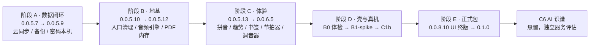

# Guitar Shell 开发任务与进度

> 这里记录开发任务、阶段进度、冒烟清单、技术债与避坑指南。面向用户的项目介绍、功能说明、截图与下载入口在 [README.md](README.md)。
>
> 当前基线：`0.1.0` 正式包候选。0.0.8.10 为 UI 终版并完成真机验收；0.1.0 已切换正式包名并使用 release 签名，发布前以真机验收和 Release 决策为准。

## 1. 当前阶段

### 1.1 0.1.0 正式包

已完成：

- `namespace` / `applicationId` 切到 `com.guitarshell`；Java 源码从 `cc/ccwu/guitarshell/spike/` 迁到 `com/guitarshell/`。
- `capacitor.config.json` 的 `appId`、`strings.xml` 的 `package_name` / `custom_url_scheme` 同步更换。
- Gradle 版本改为 `versionCode 100` / `versionName "0.1.0"`。
- npm 包名改为 `guitarshell`，版本 `0.1.0`，新增 `apk:release`。
- 网页与 Service Worker 版本同步为 `0.1.0`。
- 新建 release keystore，接入条件式 release signing；签名文件与密码配置均不进入 Git。
- 正式签名 APK 构建通过，包名、版本、v1 / v2 签名与证书指纹均已校验。

待完成：

- 真机安装 0.1.0，确认与 0.0.8.10 并存安装、启动、权限与备份恢复。
- 旧版设置抽屉导出备份 JSON，新版「从文件恢复」导入，核对乐谱、阅读进度、页级书签与练习记录。
- 用户确认后再执行源码提交、`v0.1.0` tag 与 GitHub Release；GitHub Pages 是否同步升级到 0.1.0 由用户决定。

### 1.2 包名与迁移说明

- 0.1.0 与 0.0.8.10 是独立应用，不能覆盖升级。
- 备份包含：乐谱、阅读进度、页级书签、练习记录。
- 备份不包含：WebDAV 密码保险库、主题选择。换机或重装后需要重新设置。
- 备份恢复顺序：先完整校验 dataURL，再清库写入；不要中途清空旧数据。

## 2. 演进路线



| 阶段 | 目标 | 批次 | 状态 |
| --- | --- | --- | --- |
| A 数据闭环 | 备份 / 恢复 / 云同步真正可用，数据不丢 | A1～A6 | 完成，2026-11-18 |
| B 地基 | 去掉入口噪声、统一音频、控制 PDF 内存 | B3 / B2 / B4 | 完成，0.0.5.10～0.0.5.12 |
| C 体验 | 找谱 / 统计 / 书签 / 节拍器练习能力 / 调音器专业版 | C2 / C3 / C1a / C4 / C5 | 完成，0.0.5.13～0.0.6.5 |
| D 壳与真机 | 壳前体检、宿主预演、屏幕常亮、系统能力 | B0 / B1-spike / C1b | 完成，0.0.8.1～0.0.8.10 |
| E 正式包 | 正式包名、release 签名、独立安装与数据迁移 | B1-release | 0.1.0 候选已构建，待真机验收与发布 |
| 悬置 | AI 识谱（需后端代理） | C6 | 不进主线 |

## 3. 功能盘点

| 模块 | 进度 | 已具备 | 主要缺口 |
| --- | --- | --- | --- |
| 基础外壳 | 90% | 组件隔离、导航秒切、PWA 离线、图标、版本徽标、全局设置抽屉、一键启动 | 正式包真机验收与发布 |
| 节拍器 | 95% | 高精度调度、旋钮、TAP、拍号 / 细分 / 音色、逐拍重音、Swing、变速练习、倒计时、HUD | 音频跟练（按练习曲自动对齐） |
| 读谱器 | 92% | 书架 / 标签 AND / 拼音搜索、PDF 虚拟化、手势缩放、进度双轨、页级书签、迷你节拍器同步、全屏与控件渐隐 | 单曲抽取建卡 |
| 练琴记录 | 92% | 打卡（时长 / BPM / 页码）、累计统计、SVG 趋势、TOP5、实时刷新 | 按曲目下钻、连续打卡等彩蛋指标 |
| 调音器 | 95% | 麦克风采集、YIN 基频、指针仪表、自动 / 手动选弦、A4 步进校准、音名 / 音分换算、低音尾音折叠、离页自动关麦、提示音 / 震动反馈、标准音试听、10 秒音分曲线 | 真机长时稳定性、打壳后的麦克风 / 震动权限 |
| 数据 / 服务层 | 75% | IndexedDB v3、全量备份、WebDAV 多通道、冲突检测、密码本机加密、统一音频引擎、常亮服务 | 云同步自动定时上传（当前手动） |
| 壳 / 真机层 | 45% | B1-spike 0.0.7.2 / 0.0.7.3 真机验收；后台 / 锁屏节拍器续响；0.0.8.1 常亮；0.0.8.7 原生备份写盘；0.1.0 release 签名包 | 长时 Doze 兜底、正式包真机权限稳定性 |

## 4. 版本时间线

| 版本 | 阶段 / 批次 | 状态 |
| --- | --- | --- |
| 0.0.5.6 | 基线：四大模块可用 | 已推送 |
| 0.0.5.7～0.0.5.9 | A 数据闭环：云同步 / 备份 / 密码本机 | 已推送 |
| 0.0.5.10～0.0.5.12 | B 地基：入口清理 / 音频引擎 / PDF 内存 | 已推送 |
| 0.0.5.13～0.0.5.14 | C 找谱 / 练习趋势 | 已推送 |
| 0.0.5.15～0.0.6.0 | C1a 页级书签 + C4 节拍器满血 | 已验收推送 |
| 0.0.6.1～0.0.6.5 | C5 调音器专业版 | 已验收推送 |
| 0.0.7.0 | B0 打壳前体检 + B1-spike 预演包 | 已验收推送 |
| 0.0.7.1～0.0.7.2 | B1-spike 真机反馈修复 + 低音弦响度补偿 | 已验收推送 |
| 0.0.7.3 | 迷你节拍器步进 / 提示音抗干扰 / 读谱全屏与控件渐隐 | 已验收推送 |
| 0.0.8.0 | C1b 首包（原生插件通道未生效） | 被 0.0.8.1 取代 |
| 0.0.8.1 | C1b 屏幕常亮（nativePromise 通道修正） | 已验收推送 |
| 0.0.8.3 | UI 复古木质 / 深夜琴房重构（9 色 token 全局换肤） | 已真机验收推送 |
| 0.0.8.4 | UI 细节修正第一版（图标未通过，被 0.0.8.5 取代） | 读谱 / 记录页 / 顶部图标已验收 |
| 0.0.8.5 | 启动图标缩放 / 全局去蓝色选中框 / 节拍器木鱼音色 | 图标已真机验收推送 |
| 0.0.8.6 | 全局设置抽屉 / 读谱翻页热区缩小 | 已真机验收 |
| 0.0.8.7 | 数据管理归拢 / 原生备份 / 读谱书架精简 / 齿轮右对齐 | 已真机验收推送 |
| 0.0.8.8 | UI 终版：书架标题单行省略 / 附件终稿启动动画 | 已真机验收（启动时长由 0.0.8.9 修正） |
| 0.0.8.9 | 启动动画压缩到 1.46 秒 / 蜗牛每次随机起点 | 已真机验收推送 |
| 0.0.8.10 | 双主题 UI 终版：暖纸日光 / 复古木质 | 已真机验收推送；GitHub Release 已转正式 |
| 0.1.0 | 正式包名 / release 签名 / 数据迁移 | 本地候选已构建，待验收与发布 |

## 5. 当前进度

- B0 打壳前体检已完成并推送：manifest / SW / toast / 安全区。
- B1-spike Capacitor 预演包 0.0.7.2 真机验收通过；后台 / 锁屏节拍器可续响。
- 0.0.7.3 体验修复通过：mini 节拍器 +/- 实时变速、提示音抗干扰、读谱全屏与控件渐隐。
- C1b 屏幕常亮通过：`js/services/wakelock.js` 按 reason 引用计数；壳内 `KeepAwake` 原生插件，网页回退 `navigator.wakeLock.request('screen')`；页不可见时释放，回到前台补申请。
- UI 复古木质重构 0.0.8.3 已真机验收并推送：全局 9 色 token，四大模块同步换肤，去掉青蓝 / 亮绿 / 霓虹发光。
- UI 细节修正 0.0.8.5 图标已验收：顶部改用项目自有图标；读谱提示统一为「上次读到的位置」；记录页趋势折叠；Android 图标按 GShell 比例重做；清除蓝色焦点框；节拍器「木鱼」音色。
- 全局设置抽屉 0.0.8.6 已验收：数据备份 / 恢复 / 清空、当前主题、关于；恢复 / 清空后广播数据事件；读谱左右热区缩到 170px 高。
- 数据管理归拢 / 原生备份 0.0.8.7 已验收推送：数据操作全部收进设置抽屉；读谱书架只留导入 / 搜索 / 排序 / 标签 / 书架；Android 备份写入 `Download/GuitarShell/`。
- UI 终版 0.0.8.8 已真机验收：书架标题单行省略；启动动画接入 `splash-preview/splash-final.html`；系统栏同步深色启动层。
- 启动动画提速 0.0.8.9 已验收推送：显示 1.2 秒 + 260ms 淡出，总时长约 1.46 秒；蜗牛随机起点。
- 日间模式 0.0.8.10 已真机验收并作为 UI 终版：深色「复古木质 · 深夜琴房」与浅色「暖纸日光 · 日间模式」双主题；主题存 `localStorage` 的 `gs_theme`，Canvas 与 Android 系统栏跟随重绘。
- 0.1.0 正式包候选：包名 `com.guitarshell`、`versionCode 100` / `versionName 0.1.0`；release keystore 本地生成并接入 Gradle 条件签名；构建与签名校验通过。
- 下一步：真机验收 0.1.0、备份恢复验证、用户决定提交与 Release。

## 6. 任务队列

| # | 任务 | 状态 | 依赖 | 备注 |
| --- | --- | --- | --- | --- |
| 1 | C5 调音器专业版 | 已验收 | `audio.js` | YIN + A4 步进 / 标准音 / 音分曲线 + 离页关麦 + 反馈 |
| 2 | B0 打壳前体检 | 已验收 | C5 验收通过 | manifest / SW / toast / 安全区 |
| 3 | B1-spike Capacitor 预演包 | 0.0.7.3 已验收 | B0 | 后台 / 锁屏节拍器续响 |
| 4 | C1b 屏幕常亮 | 0.0.8.1 已验收 | B1-spike | 原生 + Web 双路径，引用计数 |
| 4b | UI 复古木质重构 | 0.0.8.3 已验收推送 | C1b | 9 色 token，全局换肤 |
| 4c | UI 细节修正 | 0.0.8.5 图标已验收 | 4b | 图标 / 读谱提示 / 记录页 / 木鱼音色 |
| 4d | 全局设置抽屉 | 0.0.8.6 已验收 | 4c | 设置 + 数据管理 + 主题 |
| 4e | 数据管理归拢 / 原生备份 | 0.0.8.7 已验收推送 | 4d | 备份写盘、书架精简 |
| 5 | UI 终版 | 0.0.8.10 已验收推送 | 4e | 双主题、单行省略、启动动画 |
| 6 | B1-release 正式包 | 0.1.0 候选中 | UI 终版 | 包名、签名、迁移、Release |
| 7 | C6 AI 识谱 | 悬置 | 独立后端 | 需要模型 key 与代理，不进主线 |

## 7. 冒烟清单

- [ ] 导入 PDF / 图片，书架出卡。
- [ ] 打开谱，缩放拖拽，存进度，返回书架后重开仍在同一页。
- [ ] 左右热区切歌，目标谱回到上次位置（A / B 不退回第一页）。
- [ ] 打卡后记录页自动刷新并显示页码。
- [ ] 本地备份生成 JSON；清库后从文件恢复，乐谱 / 打卡 / 进度 / 书签完整。
- [ ] 云上传后另一台设备云下载，书架与进度一致。
- [ ] 节拍器与迷你节拍器不同时发声；调音器能识别六弦。
- [ ] 调音页 A4 步进到 432，标准音试听，音分曲线随拨弦起伏；切离页面麦克风立即关闭。
- [ ] 调准时只提示 / 震动一次，开关可关；刷新后 A4 与开关状态保留。
- [ ] 打包后锁屏 / 切后台，节拍与调音不中断。
- [ ] 节拍器播放 / 读谱打开 / 调音监听时屏幕常亮；停止或切走后恢复系统熄屏。
- [ ] 0.1.0 与 0.0.8.10 并存安装；旧版备份 JSON 在新版成功恢复。

## 8. 运行、构建与发布

### 本地开发

```bat
start-dev.bat
```

一条命令同时启动本地静态页与 Node WebDAV 代理，手机连接同一 Wi-Fi 即可访问。

### Android 正式包

```bash
npm install
npm run apk:release
```

构建前会自动执行 `npm run www` 与 `cap sync android`。产物位于 `android/app/build/outputs/apk/release/app-release.apk`。

### 发布检查

- 同步修改 `js/services/version.js` 与 `sw.js` 的 `APP_VERSION`，否则线上 cache-first 会继续吃旧文件。
- 新文件若被静态 import，必须加入 `sw.js` 的缓存清单。
- `www/` 与 `dist/` 默认不进入 Git；release keystore、`keystore.properties`、`*.jks`、`*.keystore` 必须保持在 `.gitignore` 中。
- GitHub Pages 源为 `main` / root；`index.html` 即入口。
- 每次正式发布同步更新 README 的版本与下载入口，并为 GitHub Release 上传签名 APK。

## 9. 技术债

- [ ] `spark-md5.js` 未引入，`fileHash` 恒为空，去重仍靠「名称 + 大小」，改名即重复。
- [ ] 拼音词典只到首字母，不支持全拼与模糊纠错；次读音可能带来轻微误匹配。
- [ ] 云同步仍为手动触发，未做定时或退出前提醒。
- [ ] 单曲抽取建卡未实现。
- [ ] 音频跟练（按练习曲自动对齐）未实现。
- [x] `manifest.json` 的 `start_url` / `scope` 已改为相对 `./`。
- [x] 已补 `CHANGELOG.md`，提交按 `feat:` / `fix:` / `chore:` 规范。
- [x] `sw.js` 的 `base` 死代码已删除，缓存清单与静态 import 对齐。
- [x] APK 内 Service Worker 策略已定：壳内跳过注册，网页端保留。
- [x] 调音器麦克风失败已改为应用内 toast + 状态提示，并复位按钮 / 停止音轨。

## 10. 避坑指南

1. **缓存魔咒**：改代码必须升 `sw.js` 的 `APP_VERSION`，否则 cache-first 永远喂旧文件。
2. **路径刺客**：`pdf.js` 用相对路径本地化加载，手机端浏览器极严格。
3. **音频叠加**：lookahead `setInterval` 退出务必 `clearInterval`；主 / 迷你节拍器互斥交给引擎，不靠事件。
4. **切勿推倒重来**：零构建、原生 Web、拖拽部署是最敏捷的武器；切香肠，享受微小迭代。
5. **进度双轨制**：手动 + 弱自动；不要改成「滚动即写库」——那正是旧版永远滞后一个会话的根源。
6. **恢复要原子**：先把 dataURL 全部转 Blob 并校验，全部成功后才清库写入；顺序反过来会中途清空用户数据。
7. **iframe 已死**：PC 端曾用浏览器 PDF 阅读器，它劫持滚动与事件；换回 iframe 会连带摧毁进度、热区与节拍器虚化。
8. **加字段不等于升库版本**：object store 无固定表结构，新字段只需读写时归一化缺省值，不必动 `DB_VERSION`。
9. **DOM 引用别靠闭包**：跨函数修改的 UI 用 `this.shadowRoot.getElementById()` 实时取，避免停止按钮失效。
10. **浮层脱离滚动容器**：热区 / 药丸 / 迷你节拍器挂 `:host` 直属层并 `position:absolute`，左右留 20px+ 安全距离。
11. **`!important` 会打败内联样式**：需要 JS 控制显隐的元素，样式表不要加 `!important`。
12. **切歌前先存位**：返回书架、左右翻页都必须先 `saveReadingProgress()`。
13. **云同步通道必须能换**：端点绝不写死；排查先点「测试连接」。被静态 import 的服务文件必须进 `ASSETS_TO_CACHE`。
14. **版本号有两处**：`sw.js` 与 `js/services/version.js` 同步改；新文件进缓存清单。
15. **同步点 key 带路径**：`gs_cloud_sync:<path>`，换账号 / 路径不会误判。
16. **密码只进 vault**：AES-GCM、密钥不可导出；不写 localStorage、不进备份、不 `console.log`；局域网 http 自动隐藏保存功能。
17. **音频只走 `audio.js`**：组件里禁止 `new AudioContext()` / `close()`；发声用 `click()` / `startMetronome()`，麦克风用 `openAnalyser()`。
18. **节拍互斥在引擎里**：`startMetronome()` 自动停上一路并回调 `onStop('preempted')`；组件只在 `preempted` 时复位按钮，避免递归停。
19. **变速练习的 N 有两层含义**：每 N 小节加一档，抵达目标后也保持 N 小节再停；`rampHoldBars` 从 0 起算，避免刚到位就收工。
20. **低音弦尾音会锁到二次谐音**：E2 基频衰减后只剩 164.8Hz，YIN 会当成 D3；检测结果必须先经 `foldToGuitarFundamental()` 按六弦目标折叠，再进中值滤波。正常 E4（329.6Hz）本身是弦目标，不能被折成 A2。
21. **调音器离页必须真关麦**：组件是常驻 DOM、切页只换 `active` 类，不会触发 `disconnectedCallback`；必须监听 `app-tab-changed` 主动 `stopTuner()`。异步 `getUserMedia` 要用 `stopEpoch` 作废旧请求，否则刚点开启就切页会把麦克风偷偷打开。
22. **标准音试听会串进麦克风**：扬声器播参考音时若不暂停检测，麦克风会把 1.2 秒正弦当成琴声、污染音分曲线；用 `isPlayingRef` 跳过检测，结束后清空历史再恢复。
23. **自定义音效是两处开关**：替换内置「叮」要同时改 `audio.js` 的 `CUSTOM_CHIME_URL` 与 `sw.js` 缓存清单，漏一处就会离线回落到合成音或加载失败。
